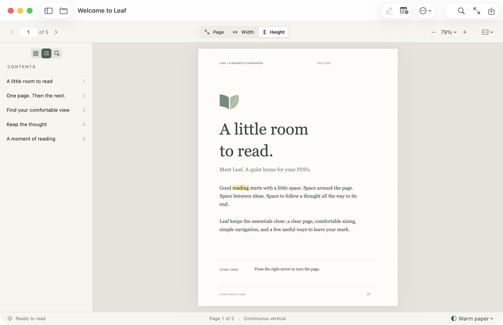
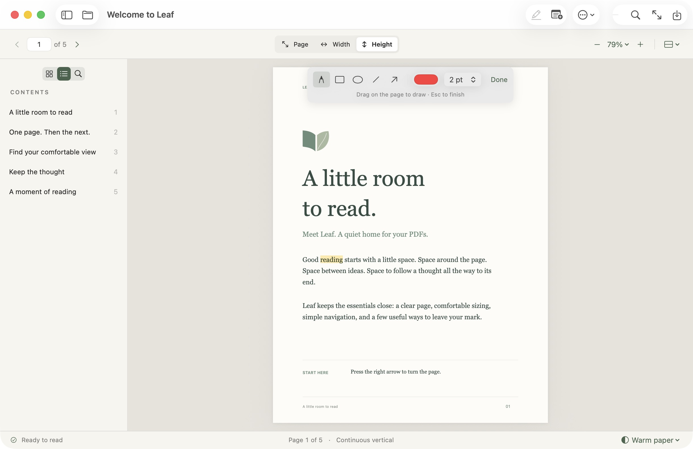

# Leaf

[](https://github.com/SalehMuAm/Leaf/actions/workflows/ci.yml)

A lightweight native macOS PDF reader and annotation editor. Built with Swift, AppKit, SwiftUI, and Apple's PDFKit, with no third-party dependencies.

Leaf gives the page room to breathe: a quiet sage interface, readable controls, a collapsible sidebar, and fast access to the ways you actually read.



**Early public beta.** The deployment target is macOS 14 or newer. The app has been tested locally on Apple silicon with macOS 26.6.2 and Xcode 26.6 (Swift 6.3.3, SDK 26.5). Compatibility with Intel Macs and older macOS versions still needs hands-on testing.

## Features

- Open PDFs, including from Finder or drag and drop.
- Navigate with arrow buttons, left/right arrow keys, or a page number.
- Fit the page, width, or height; zoom freely; read vertically, horizontally, one page at a time, or in two-page spreads.
- Browse thumbnails and document outlines; search selectable text.
- Highlight selected text, add notes, fill PDF forms, rotate, insert, and delete pages, with undo and redo.
- Add text boxes, place them anywhere on a page, drag to move, and double-click to edit. Text size and all edits support undo.
- Draw with a freehand pen or add rectangles, ellipses, lines, and arrows. Choose a stroke color and width; each gesture supports undo and saves as a standard PDF annotation.
- Extract page ranges into a separate PDF while keeping the original document intact.
- Focus mode, warm/light/dark reading backgrounds, and recent documents.
- Save annotations or save a separate copy; print with the native macOS dialog.
- Includes a five-page welcome PDF for trying the reading and annotation tools.

Leaf is an annotation editor. It does not rewrite or reflow a PDF's existing text.

Find **Add Text Box…** and **Extract Pages…** in the existing **…** toolbar menu. Text boxes also live in **Annotate**; extraction is available in **File**. Extraction accepts entries such as `1–3, 5` and saves selected pages in document order, including their annotations.

Choose **… → Draw & Shapes** (or use **Annotate**) for the pen and shape tools. A compact palette appears while drawing; drag on a page to add a mark. Choose **Done** or press Escape to return to reading. Right-click a drawing to delete it. Escape during a drag cancels the current mark without changing the PDF.

<details>
<summary>See the drawing tools</summary>



</details>

## Install

Download the Apple silicon (`arm64`) ZIP from [Releases](https://github.com/SalehMuAm/Leaf/releases), unzip it, and move **Leaf.app** to **Applications**. Release assets include a SHA-256 checksum file.

The initial beta uses an ad hoc signature and is **not notarized by Apple**. macOS may block the downloaded app; building from source is available below. Developer ID signing and notarization remain release follow-ups. See Apple's [guidance for opening apps from outside the App Store](https://support.apple.com/en-us/102445).

## Build and run

Requires macOS 14 or newer and Apple's Swift toolchain (Xcode or Command Line Tools). Xcode 26.6 is the locally tested toolchain; the language manifest uses Swift tools 5.9.

```bash
git clone https://github.com/SalehMuAm/Leaf.git
cd Leaf
./scripts/build-app.sh
open dist/Leaf.app
```

For a faster development build, use `./scripts/build-app.sh --debug`. The app is signed locally with an ad hoc signature. Copy `dist/Leaf.app` into your Applications folder if you want to keep it there.

```bash
swift run Leaf
```

You can also open `Package.swift` in Xcode. The welcome PDF and icon resources are bundled by SwiftPM, so launching from another working directory works. See [release instructions](docs/RELEASING.md) to create ZIPs and checksums or configure Developer ID signing.

## Keyboard shortcuts

| Action | Shortcut |
| --- | --- |
| Open PDF | Command-O |
| Save / Save As | Command-S / Command-Shift-S |
| Search | Command-F |
| Previous / next page | Left / right arrow |
| Zoom in / out | Command-Plus / Command-Minus |
| Actual size | Command-3 |
| Fit page / width / height | Command-0 / Command-1 / Command-2 |
| Rotate page | Command-Shift-R |
| Highlight selection | Command-Shift-H |
| Add note | Command-Shift-N |
| Add text box | Command-Shift-T |
| Draw with pen | Command-Shift-D |
| Extract pages | Command-Shift-E |
| Focus mode | Command-Shift-F |
| Toggle sidebar | Command-Control-S |

Press Escape to cancel text placement. Double-click a text box to edit or delete it; drag it to move it.

## Verification

Run `swift test` for document and PDFKit integration tests. Tests that render PDF pages need access to macOS graphics services; a restrictive headless sandbox may prevent PDFKit from creating its rendering surfaces.

GitHub Actions builds, tests, and packages the app on macOS. See [Actions](https://github.com/SalehMuAm/Leaf/actions) for the actual runner results and [CONTRIBUTING.md](CONTRIBUTING.md) for development and manual checks.

## Limits and privacy

- Leaf adds annotations and rearranges pages. It does not edit existing PDF text, run OCR, redact sensitive content, or create digital signatures. Drawing over text does not remove the underlying content.
- There is no automatic crash recovery. Save your work regularly; use **Save As** when you want to keep an original copy.
- Complex forms, unusual fonts, and PDF features depend on PDFKit and need broader real-document testing.
- Documents stay on your Mac. Leaf has no analytics, telemetry, accounts, or network requests. Recent document locations and reading preferences are stored locally.

For bugs and feature requests, [open an issue](https://github.com/SalehMuAm/Leaf/issues). Please use a sanitized sample PDF when reporting a problem. Report vulnerabilities using the [security policy](SECURITY.md).

## Assets

The icon and welcome PDF are generated locally with macOS frameworks. To regenerate them:

```bash
swift scripts/generate-assets.swift
```

The generated app assets and welcome guide are included in the project license. See [CHANGELOG.md](CHANGELOG.md) for release notes.

## License

Leaf's code, documentation, generated assets, and welcome PDF are available under the [MIT License](LICENSE).
